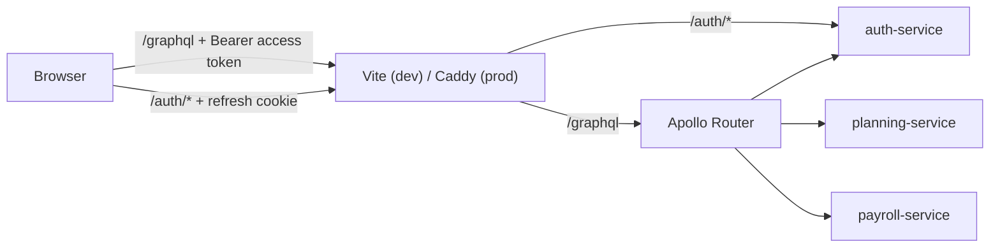
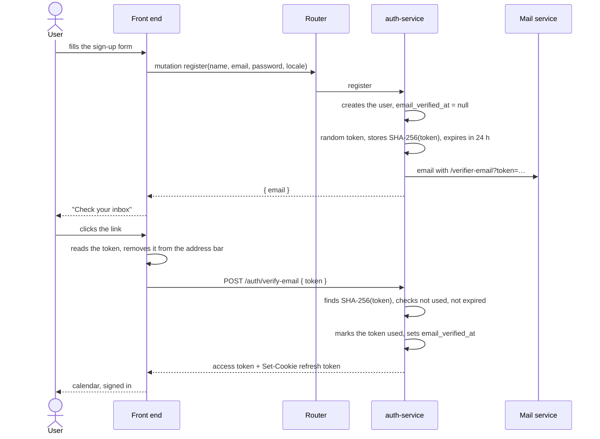
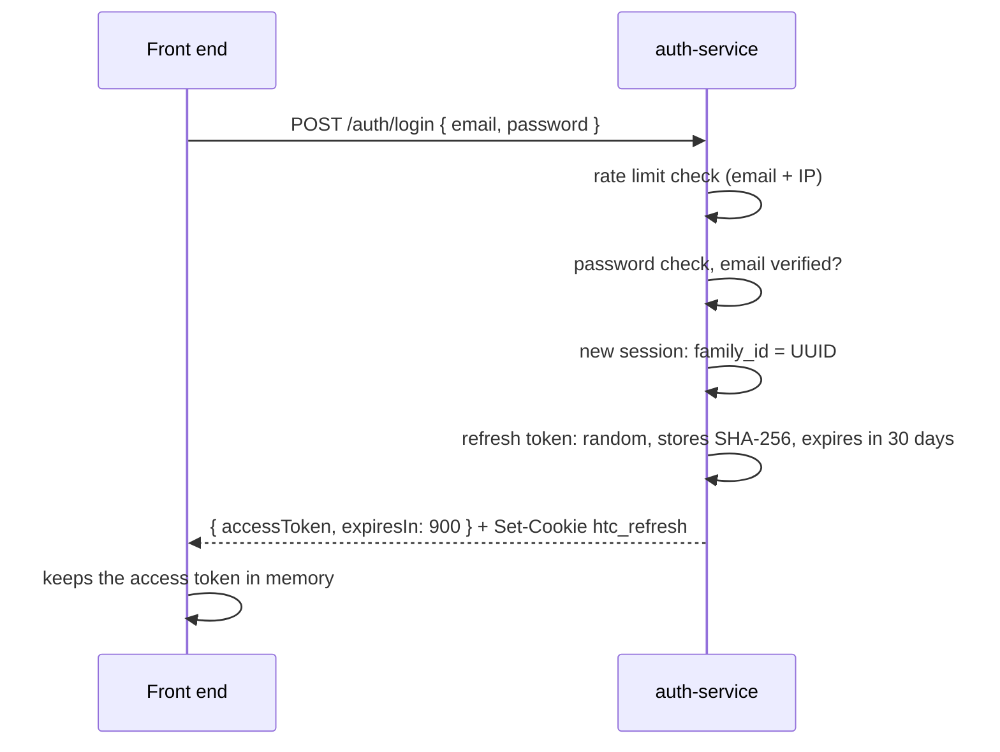
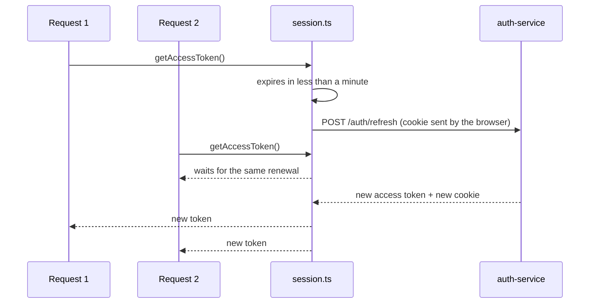
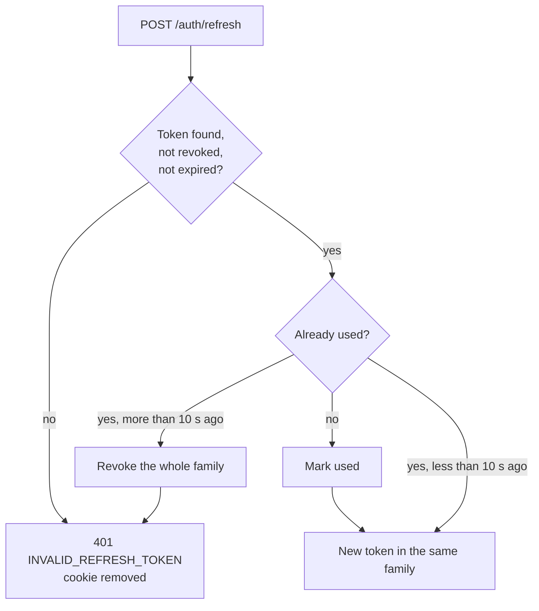
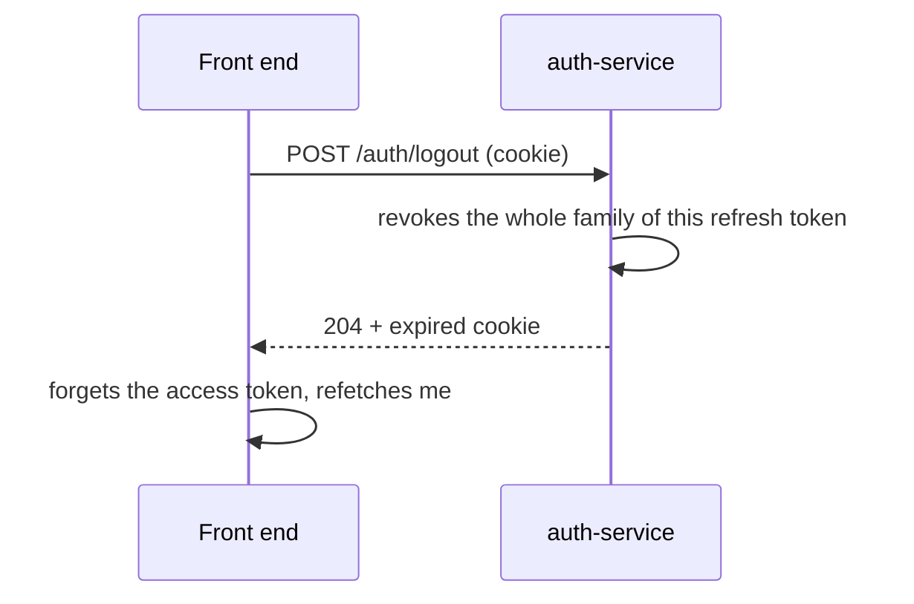

# Authentication and sessions

How users sign up, sign in, stay signed in and sign out, and why it works this way.
The README gives the overview; this document is for whoever needs to understand or change it.

## Contents

- [Overview](#overview)
- [Sign-up and email verification](#sign-up-and-email-verification)
- [Sign-in](#sign-in)
- [Calling the API](#calling-the-api)
- [Renewing the access token](#renewing-the-access-token)
- [Page reload](#page-reload)
- [Rotation and replay detection](#rotation-and-replay-detection)
- [Sign-out](#sign-out)
- [Rate limiting and account enumeration](#rate-limiting-and-account-enumeration)
- [Error codes](#error-codes)
- [Storage](#storage)
- [Design choices](#design-choices)
- [Known limits](#known-limits)
- [Configuration](#configuration)
- [Operations](#operations)
- [Where the code lives](#where-the-code-lives)

## Overview

A session is made of two tokens with very different roles.

|                     | Access token                                          | Refresh token                                      |
| ------------------- | ----------------------------------------------------- | -------------------------------------------------- |
| What it is          | JWT signed with RS256 (RSA private key of auth-service) | 64 random hex characters                         |
| Lifetime            | 15 minutes                                            | 30 days, renewed at each use                       |
| Used for            | Every GraphQL request (`Authorization: Bearer …`)     | Getting a new access token from `/auth/refresh`    |
| Where the browser keeps it | In memory (a JavaScript variable)              | httpOnly cookie, limited to `/auth`                |
| Stored on the server | Nowhere                                              | Its SHA-256 only, in `refresh_tokens`              |
| Can be revoked      | No: it expires on its own                             | Yes: sign-out, replay detection                    |
| Checked by          | Every service, with the public key                    | auth-service only                                  |

The short-lived token does the everyday work and cannot be revoked; the long-lived one can be revoked
but never leaves the `/auth` endpoints. Each covers the weakness of the other.

Everything happens on a **single origin**: the front end calls `/graphql` and `/auth` on its own address.
Vite forwards them in development (`frontend/vite.config.ts`), Caddy in production (`docker/web/Caddyfile`).



## Sign-up and email verification

Sign-up is a GraphQL mutation; verifying the email starts a session, so it is an `/auth` endpoint.



- User creation and email sending run in **one transaction**: if the email cannot be sent, no account is left
  behind, and the person can simply try again.
- The email is sent in the **user's language** (`users.locale`, from the language of the front end at sign-up).
- A new verification email **replaces** the previous links (`deleteUnusedForUser`).
- An unverified account cannot sign in (`EMAIL_NOT_VERIFIED`). This is checked **after** the password,
  so the message never tells a stranger that an address exists.

## Sign-in



The email is lowercased before any lookup, so `Jane@Example.com` and `jane@example.com` are the same account.

## Calling the API

The front end adds `Authorization: Bearer <access token>` to every GraphQL request (`src/apollo.ts`).
The router passes the header on to every subgraph (`router/router.yaml`, `headers.all.request.propagate`).

Each service checks the token on its own, with the **public key**, through its `jwt` guard:

| Check            | Why                                                       |
| ---------------- | --------------------------------------------------------- |
| RS256 signature  | Only auth-service, which holds the private key, can sign  |
| `iss` claim      | The token was issued by this application's auth-service   |
| `exp` claim      | The token has not expired                                 |
| `sub` claim      | The user id, used for every ownership check               |

No service calls auth-service to check a token: a request never depends on auth-service being up,
except to sign in or renew.

Ownership is enforced in each service, in the `User` entity resolver (`app/GraphQL/Entities/User.php`):
a user can only resolve themself. Mutations never take a user id; the user always comes from the token.

## Renewing the access token

The front end renews the access token **one minute before it expires**, right before the request that needs it,
so the user never sees an expired token.



**One renewal at a time**: the refresh token is single-use, so requests made while a renewal is running
wait for it instead of starting their own (`pendingRenewal` in `src/auth/session.ts`).

When the renewal fails (session revoked or expired), the front end clears the token, refetches `me`,
and shows the sign-in page with the message "Your session has expired".

## Page reload

The access token lives in memory, so a reload loses it. On load, the app first tries `/auth/refresh`
(`useRestoredSession`): with a valid cookie, the user is still signed in; without one, the sign-in page shows.
The `me` query waits for this attempt, so it is never sent without the token that may be coming.

## Rotation and replay detection

Every call to `/auth/refresh` **replaces** the refresh token: the old one is marked used, a new one is issued
in the same **family** (one family = one session, created at sign-in).



- **Replay = theft.** A refresh token used again a while after its rotation means two parties hold it:
  the user and someone who copied it. The whole family is revoked, so the attacker's session ends too.
  The user signs in again; the attacker cannot, without the password.
- **The 10-second grace** covers a legitimate case: two tabs renewing at the same moment with the same cookie.
  Without it, the second tab would be taken for an attacker and the user signed out for nothing.
- The new refresh token is valid 30 days **from now**: a session lasts as long as it is used at least once a month.

## Sign-out



The access token is not revoked (it cannot be): the front end forgets it, and a copy made before
sign-out stops working within 15 minutes at most. See [Known limits](#known-limits).

## Rate limiting and account enumeration

| What                         | Limit                                        | Key                       |
| ---------------------------- | -------------------------------------------- | ------------------------- |
| Failed sign-ins              | 5 per minute, then `429 TOO_MANY_ATTEMPTS`   | email + IP                |
| Verification emails resent   | 3 per hour, extra requests silently ignored | email                     |

- Keying sign-in by **email and IP together** stops password guessing on one account, without letting an
  attacker lock someone out from another network.
- A successful sign-in clears the counter.
- `resendVerificationEmail` **always** answers `true`, whether the address exists, is already verified,
  or has hit the limit: the answer never tells which emails have an account.
- Known trade-off: sign-up answers "this email is already in use", which does reveal an existing account.
  Avoiding it would need a silent sign-up (always "check your inbox", and a warning email to the real owner).
  The usual message was kept, as most sites do.

## Error codes

`/auth` answers `{ "message", "code" }`; GraphQL puts the code in `errors[].extensions.code`.
The front end translates the code, never the English message.

| Code                         | Where                    | HTTP | Meaning                                         |
| ---------------------------- | ------------------------ | ---- | ----------------------------------------------- |
| `INVALID_CREDENTIALS`        | `/auth/login`            | 401  | Unknown email or wrong password (one message)   |
| `EMAIL_NOT_VERIFIED`         | `/auth/login`            | 403  | Right password, email not verified yet          |
| `TOO_MANY_ATTEMPTS`          | `/auth/login`            | 429  | Blocked for a while, see `Retry-After`          |
| `INVALID_VERIFICATION_TOKEN` | `/auth/verify-email`     | 400  | Link unknown, already used or expired           |
| `INVALID_REFRESH_TOKEN`      | `/auth/refresh`          | 401  | No session, or expired, revoked or replayed     |
| `JSON_REQUIRED`              | every `/auth` endpoint   | 415  | The request is not JSON                         |
| `REGISTRATION_DISABLED`      | `register` (GraphQL)     | —    | `REGISTRATION_ENABLED=false`                    |

Validation errors (missing field, bad email format) keep Laravel's and Lighthouse's usual formats:
`422` with `errors` on `/auth`, `extensions.validation` in GraphQL.

## Storage

**`refresh_tokens`** (auth database)

| Column       | Content                                                     |
| ------------ | ----------------------------------------------------------- |
| `user_id`    | Owner, deleted with the user                                |
| `family_id`  | UUID shared by all the tokens of one session                |
| `token_hash` | SHA-256 of the cookie value (unique)                        |
| `expires_at` | 30 days after issue                                         |
| `used_at`    | Set when exchanged for a new token                          |
| `revoked_at` | Set at sign-out, or for the whole family on replay          |

**`email_verification_tokens`** (auth database)

| Column       | Content                                  |
| ------------ | ---------------------------------------- |
| `user_id`    | Owner, deleted with the user             |
| `token_hash` | SHA-256 of the token in the link         |
| `expires_at` | 24 hours after sending                   |
| `used_at`    | Set when the link is used                |

**`users`**: `email_verified_at` (null until verified), `locale` (language of the emails).

Nothing in the database can be turned back into a working link or cookie: only hashes are stored.

## Design choices

**Why not keep the access token in localStorage?**
Any JavaScript running on the page can read localStorage. One XSS flaw, in our code or in a dependency,
would let a script copy the token and use it from elsewhere. In memory, the token disappears with the page,
and the refresh token, in an httpOnly cookie, cannot be read by JavaScript at all.

**Why are the session endpoints outside GraphQL?**
A cookie is set with the `Set-Cookie` response header. The router merges the answers of the subgraphs and,
by default, does not pass their headers on to the browser. Forwarding it would need a router script:
possible, but fragile, and it would mix session handling with data aggregation. Plain HTTP endpoints
on auth-service are the usual pattern, and they let the cookie be limited to `/auth`.

**Why is the cookie limited to `/auth`?**
It is only sent where it is needed. It never travels with GraphQL requests, so it never reaches
the router, planning or payroll, nor their logs.

**Why SameSite=Strict and JSON only?**
Together, they close the door to cross-site request forgery (CSRF): the browser never sends the cookie
with a request started by another site, and an HTML form on another site cannot send JSON.

**Why SHA-256, and not bcrypt like passwords?**
Bcrypt is slow on purpose, to resist guessing human passwords, which are often weak.
The tokens are 32 random bytes: impossible to guess, so a fast hash is enough. And a fast, unsalted hash
can be **looked up**: the token received is hashed and searched in the table, which bcrypt's random salt prevents.

**Why RS256 rather than a shared secret (HS256)?**
With a shared secret, every service able to check a token could also forge one.
With a key pair, only auth-service holds the private key; the other services only get the public key.

**Why 15 minutes and 30 days?**
15 minutes bounds what a copied access token can do, while renewing rarely enough to cost nothing.
30 days, renewed at each use, keeps a regular user signed in without asking for the password every visit.

## Known limits

- **An access token cannot be revoked.** After sign-out, or once a session is revoked, a copy made before
  keeps working until it expires: 15 minutes at most. A deny-list checked by every service would remove this,
  at the cost of a shared store and a lookup on every request.
- **Role changes take up to 15 minutes** once roles are in the token (admin area): the old token keeps its role
  until it expires.
- **No "sign out everywhere" yet.** Revoking every session of a user is a one-line query (see below);
  it will be used by the password reset (US-24).
- **No list of active sessions or devices.** The `family_id` makes it possible later.

## Configuration

auth-service, `config/jwt.php` and `config/registration.php`:

| Variable                       | Default                       | Role                                         |
| ------------------------------ | ----------------------------- | -------------------------------------------- |
| `JWT_PRIVATE_KEY_PATH`         | —                             | Private key, auth-service only               |
| `JWT_PUBLIC_KEY_PATH`          | —                             | Public key, every service                    |
| `JWT_ISSUER`                   | `hours-tracking-calendar-auth` | `iss` claim, checked by every service       |
| `JWT_TTL_MINUTES`              | `15`                          | Access token lifetime                        |
| `JWT_REFRESH_TTL_DAYS`         | `30`                          | Refresh token lifetime                       |
| `REFRESH_COOKIE_SECURE`        | `true`                        | `false` only for local HTTP                  |
| `REGISTRATION_ENABLED`         | `true`                        | Public sign-up on or off                     |
| `EMAIL_VERIFICATION_TTL_HOURS` | `24`                          | Lifetime of the verification link            |
| `FRONTEND_URL`                 | `http://localhost:5173`       | Base of the link in the verification email   |

The 10-second replay grace is a constant in `config/jwt.php` (`refresh_reuse_grace_seconds`).

## Operations

**Get an access token for the Sandbox or curl**

```bash
curl -s -X POST http://localhost:8001/auth/login \
  -H 'Content-Type: application/json' \
  -d '{"email":"test@example.com","password":"password"}'
```

**Sign a user out everywhere**

```bash
docker compose exec auth-service php artisan tinker --execute \
  "App\Models\RefreshToken::where('user_id', 7)->whereNull('revoked_at')->update(['revoked_at' => now()]);"
```

Their access tokens keep working for 15 minutes at most.

**Clean up old tokens**

Expired and revoked rows are harmless but accumulate. They can be deleted at any time:

```sql
DELETE FROM refresh_tokens WHERE expires_at < NOW() - INTERVAL 7 DAY;
DELETE FROM email_verification_tokens WHERE expires_at < NOW() - INTERVAL 7 DAY;
```

**Rotate the JWT keys**

Generate a new pair in `secrets/jwt/` (see the README), then restart the services. Every access token
signed with the old key is refused at once; refresh tokens are not affected, so users are signed back in
silently at their next renewal.

## Where the code lives

**auth-service**

| File                                             | Role                                                      |
| ------------------------------------------------ | --------------------------------------------------------- |
| `routes/api.php`, `bootstrap/app.php`            | `/auth/*` routes, JSON-only middleware                    |
| `app/Http/Controllers/SessionController.php`     | HTTP and cookie handling, no business rule                |
| `app/Services/AuthService.php`                   | Password check, verified email, rate limiting             |
| `app/Services/SessionService.php`                | Sessions: start, rotation, replay detection, revocation   |
| `app/Services/RegistrationService.php`           | Sign-up, verification email, verification                 |
| `app/Services/TokenService.php`                  | Signs the access tokens                                   |
| `app/Exceptions/ApiException.php` and subclasses | Error codes and HTTP statuses of `/auth`                  |
| `tests/Feature/Http/SessionTest.php`             | Sign-in, rate limiting, rotation, replay, sign-out        |

**Every service**: `app/Auth/` (JWT guard, verifier), `app/GraphQL/Entities/User.php` (ownership).

**Front end**

| File                            | Role                                                        |
| ------------------------------- | ----------------------------------------------------------- |
| `src/auth/authApi.ts`           | Calls to `/auth`, error codes                               |
| `src/auth/session.ts`           | Access token in memory, renewal, one renewal at a time      |
| `src/auth/useRestoredSession.ts` | Session restore on page load                               |
| `src/apollo.ts`                 | Adds the token to every GraphQL request                     |
| `src/pages/VerifyEmailPage/`    | Email link: verification, then sign-in                      |